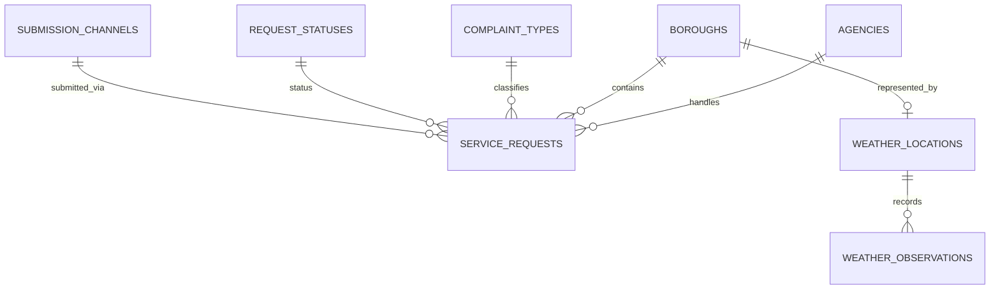

# NYC 311 Service Requests and Weather Analysis

## 1. Project Overview

This project investigates whether the volume and types of New York City 311 service requests vary with local weather conditions, time of day, and day of the week.

It combines two public data sources:

- NYC Open Data — 311 Service Requests
- Open-Meteo — Historical Weather API

Hourly weather values are collected for representative points in the five NYC boroughs: Bronx, Brooklyn, Manhattan, Queens, and Staten Island. These values can later be compared with service requests by borough and local time.

The project follows the data lifecycle:

**INGEST → STORE → CLEAN → EXPLORE → MODEL → COMMUNICATE**

M1 established the data-ingestion workflow, preserved the raw source responses, and validated the retrieved snapshot. The pipeline entry point, `src/ingest.py`, runs `src/ingest_weather.py` and then `src/ingest_nyc311.py` as separate steps and prints a summary of each result. Each ingestion script can also be run on its own. A separate weather-processing script (`src/process_weather.py`) generates derived hourly and daily CSV files. M2 adds a SQLite schema and a transactional loader that builds the database from the saved raw files without calling either source API.

## 2. Date Range and Variables

The requested date range is **2025-10-12 through 2026-10-11, inclusive**.

NYC 311 records are selected using `created_date`, without a complaint-type filter. Cursor-based pagination supports resuming large downloads from the last successfully saved record.

Hourly weather data is requested for five representative borough coordinates. Variables include:

- Temperature at 2 metres
- Relative humidity
- Precipitation
- Weather code
- Wind speed and direction
- Cloud cover

Weather timestamps are converted from Unix timestamps to the `America/New_York` timezone before local dates and daily summaries are derived.

The Open-Meteo historical archive is based on gridded model/reanalysis data, so the hourly values are modelled estimates for each coordinate point, not direct station measurements.

The five coordinates are representative points, not a dense network covering every neighbourhood. Citywide daily summaries are estimates derived from these points, not official citywide measurements.

## 3. Data Sources

### Source 1: NYC 311 Service Requests

- **Provider:** City of New York / NYC Open Data
- **Dataset:** [311 Service Requests from 2020 to Present](https://data.cityofnewyork.us/Social-Services/311-Service-Requests-from-2020-to-Present/erm2-nwe9)
- **JSON API:** https://data.cityofnewyork.us/resource/erm2-nwe9.json
- **Access:** Public Socrata JSON API
- **Requested interval:** 2025-10-12 through 2026-10-11, inclusive
- **Record identifier:** `unique_key`

At validation time, the local extraction contained 3,953,178 records. The source API count query returned the same total. The latest `created_date` returned by the source was `2026-10-10T03:03:53.000`. The requested end date is the same day the data was retrieved, so the most recent days of the snapshot are expected to be incomplete.

The dataset is publicly accessible, but a dataset-specific redistribution licence has not been confirmed for this project. Raw source files are kept out of Git because of their size and while the applicable terms remain under review.

### Source 2: Open-Meteo Historical Weather

- **Provider:** Open-Meteo
- **Documentation:** [Historical Weather API](https://open-meteo.com/en/docs/historical-weather-api)
- **API endpoint:** https://archive-api.open-meteo.com/v1/archive
- **Access:** Public HTTP GET API
- **Requested interval:** 2025-10-12 through 2026-10-11, inclusive
- **Locations:** Five representative borough coordinates
- **Licence:** Creative Commons Attribution 4.0 International (CC BY 4.0)

When publishing results based on Open-Meteo data, include appropriate attribution and a link to the licence. Suggested attribution: "Weather data by Open-Meteo.com."

See [`docs/sources.md`](docs/sources.md) for source metadata and retrieval notes.

## 4. Verified Data Status

The following results were verified locally on 2026-10-11.

### NYC 311

- **Total records:** 3,953,178
- **JSON files:** 263
- **Unique `unique_key` values:** 3,953,178
- **Duplicate keys:** 0
- **Records missing `unique_key`:** 0
- **Unreadable or invalid JSON files:** 0

The local record count matched the source API count query at the time of validation. The source may publish additional or revised records later.

### Weather Data

The raw weather response uses Unix timestamps and is stored locally under `data/raw/weather/`.

| File | Rows | Description |
|---|---:|---|
| `weather_hourly_by_borough.csv` | 43,800 | Hourly values for five borough points |
| `weather_daily_by_borough.csv` | 1,825 | Daily summaries for five boroughs over 365 dates |
| `weather_daily_citywide.csv` | 365 | Estimated daily summaries derived from the five points |

Each borough has 8,760 hourly values in the requested snapshot. All three CSV files passed the expected row-count checks and had no empty cells at the time of validation.

Daylight-saving-time checks also passed: 2025-11-02 has 25 local hourly values per borough, and 2026-03-08 has 23.

These checks establish structural consistency; they do not eliminate uncertainty in the underlying source data.

## 5. Repository Structure

```text
nyc-311-weather-analysis/
├── README.md
├── .env.example
├── .gitignore
├── requirements.txt
├── data/
│   ├── raw/                         # Local source snapshots; excluded from Git
│   ├── processed/                   # Generated weather CSVs; excluded from Git
│   └── nyc311_weather.db             # Generated SQLite database; excluded from Git
├── docs/
│   ├── evidence/
│   │   ├── README.md
│   │   ├── atomicity-mutation-test.txt
│   │   ├── checks.txt
│   │   ├── cold-rebuild.txt
│   │   ├── load-run-1.txt
│   │   ├── load-run-2.txt
│   │   ├── load-run-real-idempotence.txt
│   │   ├── real-db-state-after.json
│   │   └── real-db-state-before.json
│   ├── sources.md
│   ├── M1-Report.md
│   └── M2-Report.md
├── scripts/
│   └── verify_real_db_idempotence.py
├── sql/
│   ├── schema.sql
│   └── queries/
│       └── hourly_complaints_vs_weather.sql
└── src/
    ├── ingest.py                    # Pipeline entry point for the M1 source ingestion
    ├── ingest_nyc311.py             # NYC 311 ingestion
    ├── ingest_weather.py            # Open-Meteo ingestion
    ├── process_weather.py           # Supplementary weather processing
    ├── db.py                        # Shared SQLite connection helper
    ├── load.py                      # M2 transactional database loader
    └── checks.py                    # M2 schema, integrity, idempotence, and rollback checks
```

The tree shows the logical project layout. The raw files, generated CSVs, and database are local data products and are not committed to Git. The M2 loader requires the preserved M1 raw snapshots to be present locally; it does not download missing source data. The database is rebuilt with `src/load.py` and submitted separately when required.

## 6. Requirements

- Python 3.10 or later.
- SQLite 3.37 or later (required for `STRICT` tables). Check the SQLite library used by the active Python interpreter with:

  ```bash
  python3 -c "import sqlite3; print(sqlite3.sqlite_version)"
  ```

- `pip` and the dependencies listed in `requirements.txt`.
- Internet access is required by the M1 ingestion scripts to retrieve source data. The M2 loader works offline when the complete raw snapshots are already present under `data/raw/`.

## 7. Setup and Execution

Run these commands from the repository root in a Linux/WSL terminal:

```bash
python3 -m venv .venv
source .venv/bin/activate
python -m pip install -r requirements.txt
cp .env.example .env
```

Review `.env` and verify the requested date range and NYC 311 settings before starting an extraction. Do not commit `.env`, API credentials, or other secrets.

### Configuration

Settings are read from environment variables (see `.env.example`):

| Variable | Used by | Purpose |
|---|---|---|
| `START_DATE`, `END_DATE` | all scripts | Inclusive date range, `YYYY-MM-DD` |
| `REQUEST_TIMEOUT_SECONDS` | ingestion scripts | HTTP timeout; 120 was used for the large extraction |
| `NYC311_PAGE_SIZE` | `ingest_nyc311.py` | Records per page (1–50000; script default 1000, `.env.example` sets 20000). The verified snapshot mixes several page sizes, see below |
| `NYC311_COMPLAINT_TYPES` | `ingest_nyc311.py` | Optional comma-separated complaint-type filter; empty means all types |
| `NYC311_START_CREATED_DATE`, `NYC311_START_UNIQUE_KEY`, `NYC311_START_OFFSET` | `ingest_nyc311.py` | Optional recovery controls. Set both cursor fields together; a compatible saved checkpoint takes precedence. The offset labels raw filenames and is not sent to the API. See `.env.example`. |
| `NYC311_BASE_URL`, `WEATHER_BASE_URL` | ingestion scripts | Optional endpoint overrides |

`ingest_nyc311.py` requires `START_DATE` and `END_DATE` to be set. Load `.env` into the shell as shown below before running it.

The verified NYC 311 snapshot was not downloaded with a single page size: its 263 raw files hold 45 × 1,000, 26 × 5,000, 5 × 10,000 and 186 × 20,000 records, plus a final partial file of 8,178 records. Because pagination is cursor-based and the page size is not part of the checkpoint configuration, this only changes how records are split across files, not which records were retrieved.

### NYC 311 Ingestion

To run only the NYC 311 extraction:

```bash
set -a
source .env
set +a

export REQUEST_TIMEOUT_SECONDS=120
python -u src/ingest_nyc311.py
```

The extraction may take a long time because the selected interval contains millions of records. The script uses cursor-based pagination and saved checkpoints (`data/raw/nyc311/.cursor_checkpoint.json`) to support resuming interrupted extractions. Do not delete existing raw files or checkpoint files when recovering from a failed run. Review the terminal summary and local files before deciding whether another extraction is needed.

Note: if the checkpoint already points to the end of the requested range, running the script again retrieves no new records and may save an empty page file. Check `data/raw/nyc311/` for empty files after such a run.

### Weather-Only Ingestion and Processing

To retrieve a new weather snapshot without running the large NYC 311 extraction, use:

```bash
set -a
source .env
set +a

export REQUEST_TIMEOUT_SECONDS=120
python -u src/ingest_weather.py
python -u src/process_weather.py
```

The weather ingestion script saves the raw API response using Unix timestamps. The processing script reads the `*_weather_unix.json` file with the latest UTC timestamp embedded in its filename, matching the M2 loader's selection rule, converts timestamps to New York local time, and generates hourly, borough-level daily, and estimated citywide daily CSV files under `data/processed/`. These derived files are ignored by Git and can be regenerated from the raw weather response.

### Full Pipeline

To run both ingestion scripts in sequence (weather first, then NYC 311):

```bash
set -a
source .env
set +a

export REQUEST_TIMEOUT_SECONDS=120
python -u src/ingest.py
```

This downloads a new weather snapshot every time it is run. It does not run `process_weather.py`; run that script separately afterwards.

## 8. Validation and Join Strategy

NYC 311 validation checks include:

- JSON readability
- Total record count
- Presence and uniqueness of `unique_key`
- Comparison of the local count with a source API count query

Weather validation checks include:

- Expected hourly array lengths
- Requested local-date coverage
- Unique and consecutive UTC timestamps
- Expected row counts in derived CSV files
- Correct handling of daylight-saving-time transitions

For later analysis, service requests can be associated with weather using borough and local hour. NYC 311 `created_date` values are published without a timezone offset and are treated as New York local time. Localize them to `America/New_York` (do not convert them from UTC) before joining with weather timestamps. Two daylight-saving-time edge cases need explicit handling: 2025-11-02 01:00–01:59 occurs twice (ambiguous local times), and 2026-03-08 02:00–02:59 does not exist (nonexistent local times). Records with a missing borough or the `UNSPECIFIED` borough value cannot be matched to one of the five representative borough weather points.

Daily files can support comparisons of complaint volume with daily weather summaries. Such relationships are observational and do not, by themselves, prove that weather caused changes in complaints.

## 9. Known Limitations

- **Recent NYC 311 coverage:** The requested range ends on 11 October 2026, but the latest `created_date` in the saved NYC 311 snapshot is `2026-10-10T03:03:53.000`. The snapshot contains no requests dated 11 October 2026 and only partial coverage for 10 October. Treat the most recent days as incomplete in later analysis.
- **Weather snapshot timing:** The weather snapshot was retrieved at `2026-10-11T18:38:14Z`, but includes observations through `2026-10-12T03:00:00Z` (23:00 local time on 11 October). The latest hourly values were therefore beyond the retrieval time and should be treated as preliminary/modelled values, not settled historical observations.
- **Weather-grid similarity:** All five borough series have 8,760 aligned hourly timestamps. Across the ten borough pairs, Pearson temperature correlations range from `0.995132` to `0.998818`; precipitation correlations range from `0.606599` to `0.828007`. No pair has an exactly identical temperature series or precipitation series. Temperature patterns are highly similar, so borough-specific weather effects should be interpreted cautiously; precipitation varies more across the selected grid points.
- **Modelled weather values:** Open-Meteo provides gridded model/reanalysis estimates for five representative coordinates, not direct station measurements or a dense neighbourhood-level weather network.
- **Timestamp edge cases:** NYC 311 `created_date` values have no timezone offset and must be localized to `America/New_York`. In the saved snapshot, 796 creation timestamps fall in the repeated DST hour on 2 November 2025 and one falls in the nonexistent local hour on 8 March 2026. Those records are retained without invented UTC instants and are excluded from the UTC-hour weather join.
- **Unspecified borough:** 3,958 of 3,953,178 requests (`0.1001%`) have borough `UNSPECIFIED`; they remain in the database but cannot be joined to one of the five borough weather locations.
- **Live source changes:** NYC 311 may publish additional or revised records after retrieval, so later source queries may return different counts. See [`docs/M1-Report.md`](docs/M1-Report.md) for the wider ingestion limitations.

## 10. M2 — Schema Design and Database Load

### 10.1 Database implementation

M2 adds a local SQLite database built from preserved raw JSON files.
The loader reads `data/raw/` and does not call either source API.
The database is stored at `data/nyc311_weather.db`, which is excluded
from Git and must be submitted separately where required.

All nine tables use SQLite `STRICT` typing. Each table has a
`retrieved_at` value recording the relevant source snapshot time.
Foreign-key enforcement is enabled immediately when the database
connection opens. Data loading uses a transaction so that a fatal
loading error rolls back the data changes.

The schema is defined in `sql/schema.sql`. Database connection management is implemented in `src/db.py`, the loader in `src/load.py`, and automated tests in `src/checks.py`. The more detailed source audit, design rationale, and milestone checklist are in [`docs/M2-Report.md`](docs/M2-Report.md).

### 10.2 Entity relationship diagram



`QUARANTINE_RECORDS` is independent of the entity tables because a
rejected record may not have trustworthy foreign-key values. It stores
the source file, source row number, reason, original JSON, and retrieval
timestamp.

### 10.3 Table grain and key decisions

| Table | Grain and key |
|---|---|
| `agencies` | One row per source agency code. `agency_id` is the surrogate primary key; `agency_code` is unique. |
| `boroughs` | One row per borough value. `borough_id` is the surrogate primary key; `borough_name` is unique. `UNSPECIFIED` is retained. |
| `complaint_types` | One row per observed complaint type. The type name is unique. The design does not limit the number of types. |
| `request_statuses` | One row per observed request status, identified by a surrogate key and unique status name. |
| `submission_channels` | One row per observed submission channel, identified by a surrogate key and unique channel name. |
| `weather_locations` | One row per representative weather point. Each row references one borough. Requested coordinates and returned model-grid coordinates are stored separately. |
| `service_requests` | One row per NYC 311 request. `unique_key` is the natural primary key. Foreign keys reference agency, borough, complaint type, status, and submission channel. |
| `weather_observations` | One row per weather location and UTC hour. The composite primary key is `(weather_location_id, observed_at_utc)`. |
| `quarantine_records` | One row per source file, source row number, and quarantine reason. The original JSON is retained. |

All 44 inspected NYC 311 source fields have destinations in the database.
Some are stored directly in `service_requests`, some are represented by
foreign keys, and the GeoJSON `location` value is preserved as JSON text.
Source timestamp strings are stored separately from normalized UTC values.

### 10.4 Source audit findings

The raw-snapshot totals and ingestion validation are summarized in Section 4 and [`docs/M1-Report.md`](docs/M1-Report.md). Before choosing the database keys, the source audit confirmed that every observed `unique_key` is non-null and distinct, with no duplicate keys or conflicts in the tested `created_date`, `complaint_type`, or `borough` attributes.

The categorical values observed were 194 complaint types, 16 agency codes, 7 statuses, 5 submission channels, and 6 borough values, including `UNSPECIFIED`. A total of 3,958 requests (`0.1001%`) have borough `UNSPECIFIED`; those records remain in `service_requests`, but there is no corresponding weather location for that borough value. Another 82,051 requests lack latitude and longitude; missing coordinates are stored as `NULL`, not used to discard the requests.

The weather snapshot has five locations and 43,800 hourly observations, with 8,760 aligned timestamps per location and no duplicate timestamps, hourly gaps, missing hourly variables, or invalid numeric types in the seven requested variables. Returned weather-grid coordinates are stored separately from requested coordinates.

The database contains these row counts after loading:

| Table | Loaded rows |
|---|---:|
| `agencies` | 16 |
| `boroughs` | 6 |
| `complaint_types` | 194 |
| `request_statuses` | 7 |
| `submission_channels` | 5 |
| `weather_locations` | 5 |
| `service_requests` | 3,953,178 |
| `weather_observations` | 43,800 |
| `quarantine_records` | 0 |

### 10.5 Timestamp normalization and limitations

The NYC 311 source timestamps do not provide explicit timezone offsets.
Naive source timestamps are interpreted as `America/New_York` local time.
Unambiguous timestamps are converted to UTC, and the original source
string is retained.

Daylight-saving-time edge cases are not assigned invented UTC values.
Ambiguous and nonexistent local timestamps retain their source strings
and receive a timestamp-quality status. For `created_date`, the loaded
table contains 3,952,381 normalized timestamps, 796 ambiguous local
timestamps, and 1 nonexistent local timestamp. The request records
themselves remain in `service_requests`.

Missing optional dates remain `NULL`. In particular, 3,938,171 records
have no `due_date` value. Missing coordinates are also represented as
`NULL` rather than causing an otherwise valid request to be discarded.

Requests with `UNSPECIFIED` borough values cannot be directly matched
to one of the five weather points. Weather observations are modelled
estimates for representative points, not measurements for every
neighbourhood. Any relationship between weather and request volume is
observational and does not establish causation.

### 10.6 Missing values, unknown references, and changes over time

**Key validation.** The raw audit found 3,953,178 non-null, distinct `unique_key` values across the 3,953,178 NYC 311 records. No duplicate or missing request keys were found in this snapshot. The entity dimensions use stable natural values such as `agency_code`, `borough_name`, `complaint_type`, `status_name`, and `channel_name`; their rows receive surrogate integer primary keys. A weather event is identified by `(weather_location_id, observed_at_utc)`.

**Missing and non-numeric values.** Missing optional dates and unavailable coordinates are stored as `NULL`, not as zero. The audited snapshot contains 82,051 requests without latitude/longitude, and those requests remain in `service_requests`. The loader converted 15,484,998 numeric source strings into typed numeric values; the run summary reported zero empty-string-to-NULL conversions. Required request values that are missing or cannot be normalized are recorded in `quarantine_records` with the source location, reason, and original JSON. No request records were quarantined in the verified load. Invalid or out-of-range weather values raise a load error and roll back the transaction rather than being silently accepted.

**Unknown references.** The loader creates or updates dimension rows from the source's agency, borough, complaint-type, status, and channel values before inserting the corresponding service request. A new source value therefore becomes a new dimension member instead of leaving an orphaned foreign key. Records with unusable required fields are quarantined. The loader runs `PRAGMA foreign_key_check` before committing; a referential-integrity failure aborts and rolls back the load.

**Changes over time.** For a known natural key, a newer `retrieved_at` snapshot wins and updates the current dimension attributes. This is a current-state/Type 1 approach; the schema does not preserve a full history of dimension versions. Where the label itself is the natural key (for example, a complaint-type name), a changed label is represented as a separate dimension value rather than being linked automatically to the old label. The raw source strings and `retrieved_at` provenance are retained to support traceability.

### 10.7 Analytical query and example result

The query in `sql/queries/hourly_complaints_vs_weather.sql` counts requests by borough, local date, local hour, and complaint type, and attaches weather for the corresponding UTC hour. Its result grain is one row per borough, local date, local hour, and complaint type. Requests with ambiguous or nonexistent creation timestamps have no normalized UTC instant and are excluded from this UTC-hour join. The inner join to `weather_locations` also excludes `UNSPECIFIED`, which has no representative weather location. A `LEFT JOIN` preserves aggregated request groups if an expected weather observation is missing.

To execute the query using Python's built-in SQLite library, run this from the repository root. Change the bound dates as needed; `start_date` is inclusive and `end_date` is exclusive.

```bash
python3 - <<'PY'
from pathlib import Path
import sqlite3

query = Path("sql/queries/hourly_complaints_vs_weather.sql").read_text(encoding="utf-8")
with sqlite3.connect("data/nyc311_weather.db") as connection:
    rows = connection.execute(
        query,
        {"start_date": "2025-10-12", "end_date": "2025-10-13"},
    ).fetchmany(5)
for row in rows:
    print(row)
PY
```

For the local date 2025-10-12 (`start_date = 2025-10-12`, `end_date = 2025-10-13`), the query returned:

| Metric | Result |
|---|---:|
| Result rows (aggregated groups) | 2,448 |
| Distinct complaint types represented | 118 |
| Joined requests represented | 9,990 |
| Groups without a matching weather observation | 0 |

Examples from the highest-count result rows:

| Borough | Local hour | Complaint type | Requests | Temperature (°C) | Precipitation (mm) |
|---|---:|---|---:|---:|---:|
| BRONX | 00:00 | NOISE - RESIDENTIAL | 133 | 16.9 | 0.0 |
| BRONX | 22:00 | NOISE - RESIDENTIAL | 110 | 13.5 | 1.5 |
| BRONX | 23:00 | NOISE - RESIDENTIAL | 108 | 13.6 | 1.2 |
| BRONX | 20:00 | NOISE - RESIDENTIAL | 107 | 13.1 | 0.7 |
| BRONX | 01:00 | NOISE - RESIDENTIAL | 105 | 16.7 | 0.0 |

These results demonstrate that the query executes and associates request counts with hourly weather; they do not establish that weather caused the complaint patterns. The query plan confirmed use of `idx_requests_local_date` for the date-range filter.

### 10.8 Build, load, and validation instructions

Run commands from the repository root with the project's virtual environment activated.

**Important for a fresh clone:** `data/raw/` is excluded from Git. Restore the complete verified M1 raw snapshot locally before running the loader: the 263 NYC 311 JSON pages under `data/raw/nyc311/` and the verified `*_weather_unix.json` file under `data/raw/weather/`. The M2 loader makes no API calls and cannot recreate missing raw inputs. A subset is sufficient for a small development test but will not reproduce the recorded full database row counts.

Build or update the database:

```bash
python -u src/load.py
```

Compile the M2 scripts and run the schema, loader-level DST, quarantine, new-dimension, content-based idempotence, and rollback checks:

```bash
python -m py_compile src/db.py src/load.py src/checks.py scripts/verify_real_db_idempotence.py
python -u src/checks.py
python -u scripts/verify_real_db_idempotence.py
```

To regenerate the two loader summaries and the normal test output in the repository's evidence folder (requires the complete raw snapshot):

```bash
mkdir -p docs/evidence
set -o pipefail
python -u src/load.py 2>&1 | tee docs/evidence/load-run-1.txt
python -u src/load.py 2>&1 | tee docs/evidence/load-run-2.txt
python -u src/checks.py 2>&1 | tee docs/evidence/checks.txt
```

The commands above save run logs in `docs/evidence/`. If the course system requires separate uploads, copy the relevant log files from that folder to `~/M2-submission/`; the committed copies remain in the repository.

Run `python -u scripts/verify_real_db_idempotence.py` to compare the saved before/after states with the current local database. It scans all table contents and may take several minutes; it does not rerun the loader.

Different source snapshots or retrieval metadata can legitimately change hashes.

The full load reads local source files only. On the recorded snapshot, each full run processed 3,953,178 NYC 311 requests and 43,800 weather observations; the additional full reload reported 3,953,178 valid request UPSERT attempts and zero quarantine candidates. The subsequent full reload left row counts and SHA-256 row-content hashes unchanged in all nine tables. The hashes include `retrieved_at` and are computed in deterministic `rowid` order. The synthetic idempotence check uses the same content-hash method on its fixture database; the atomicity check compares table state before and after an injected load failure.

The validation files committed under `docs/evidence/` are `load-run-1.txt`, `load-run-2.txt`, `load-run-real-idempotence.txt`, `real-db-state-before.json`, `real-db-state-after.json`, `checks.txt`, `cold-rebuild.txt`, and `atomicity-mutation-test.txt`. The baseline JSON was recorded before the additional reload and the after-state JSON after it. The mutation log records the expected atomicity assertion failure when `rollback()` was deliberately replaced with `commit()`; the separate `checks.txt` file records the normal passing run.

The generated `data/nyc311_weather.db` file is excluded from Git and should be delivered separately in a format accepted by the course submission system. Raw source files also remain excluded from Git. Open-Meteo-derived outputs should include the attribution “Weather data by Open-Meteo.com” and a link to the provider and applicable licence.

For more detailed milestone evidence and design rationale, see [`docs/M2-Report.md`](docs/M2-Report.md).

The cold-rebuild log records a full load into a newly created temporary SQLite database: all 3,953,178 service requests and 43,800 weather observations were inserted, the quarantine count was zero, and the foreign-key check passed. The subsequent nine-table SHA-256 comparison matched the saved full-database after-state; both command outputs are recorded in `docs/evidence/cold-rebuild.txt`. The temporary database was removed after verification and is not committed.

## 11. Current Status

**M1 — INGEST:** The saved NYC 311 and Open-Meteo snapshots and their recorded structural checks are documented in [`docs/M1-Report.md`](docs/M1-Report.md). Live source datasets may change after retrieval.

**M2 — STORE:** The relational schema, transactional loader, source-to-database transformations, content-based synthetic idempotence check, rollback check, and hourly complaint/weather query are implemented. The full local database contains 3,953,178 service requests and 43,800 weather observations, with zero quarantined records and a passing foreign-key check. The synthetic test script reports `ALL CHECKS PASSED`. A subsequent full reload left row counts and SHA-256 content hashes unchanged in all nine tables; the baseline, after-state, and reload log are retained in `docs/evidence/`. A cold rebuild from an empty temporary database also matched the saved after-state hashes for all nine tables; the load and comparison outputs are recorded in `docs/evidence/cold-rebuild.txt`.

The database is a local, reproducible product built from the landed raw files and is intentionally excluded from Git. See [`docs/M2-Report.md`](docs/M2-Report.md) for the milestone design decisions and validation details.

## 12. Team

- Şeyma Nur Demirkoparan — GitHub: `@seng-210717026`
- Melike Aldemir — GitHub: `@se-210717019`
