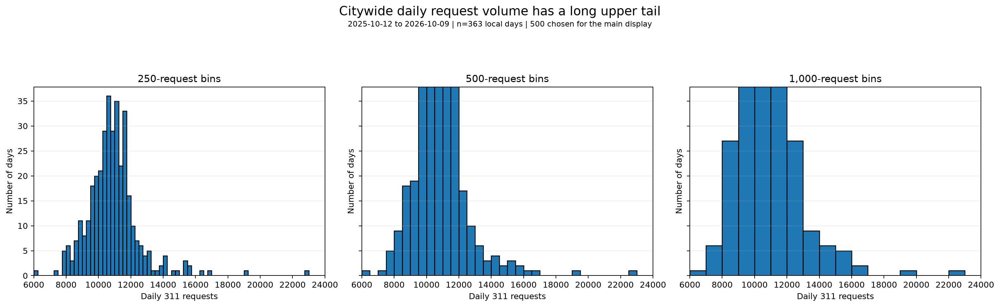
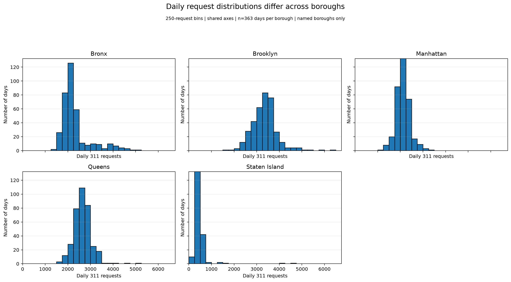
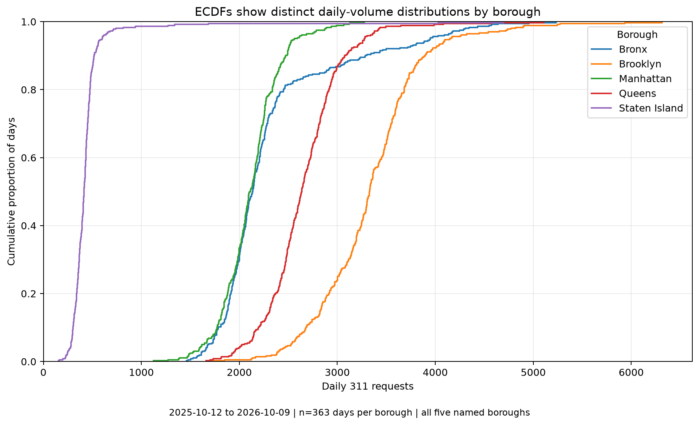
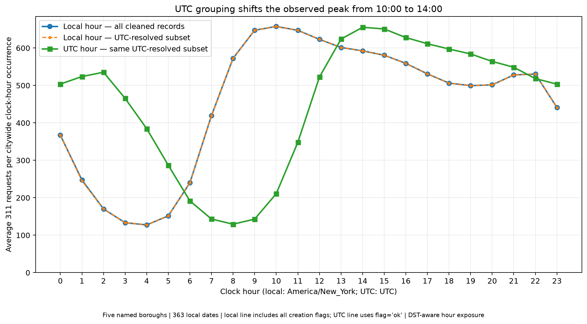
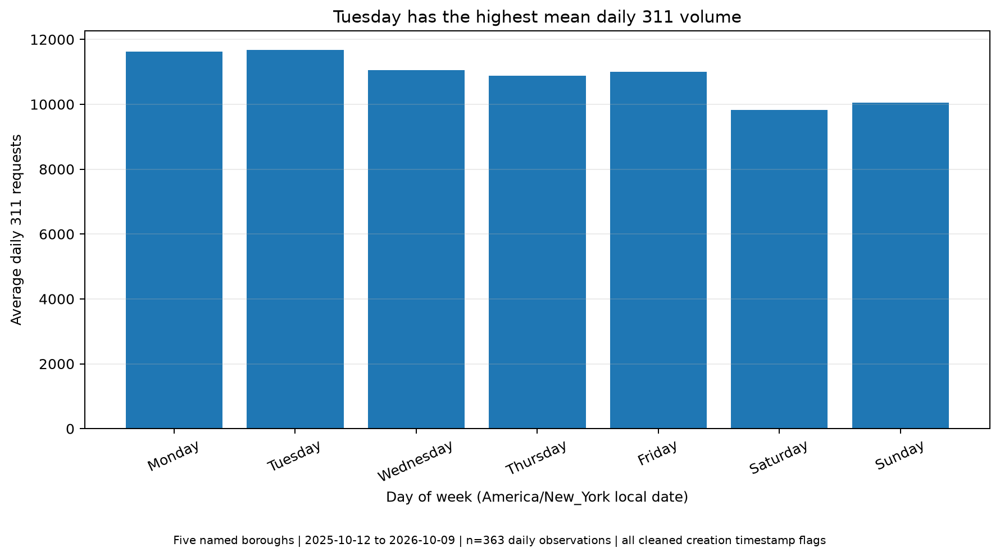
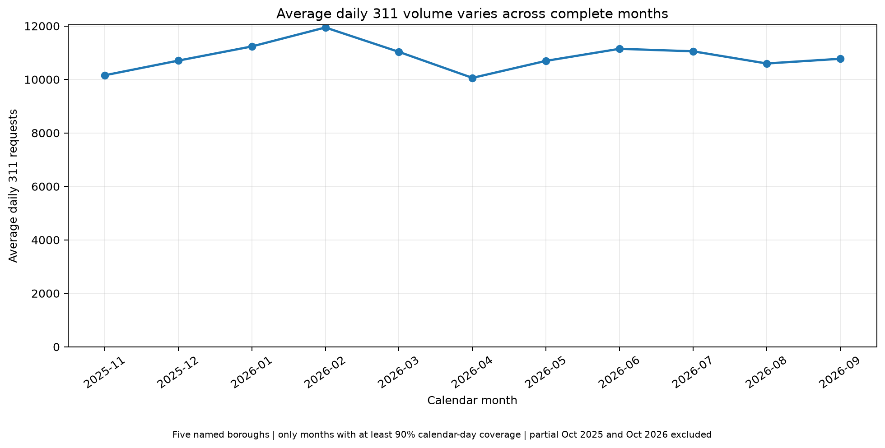
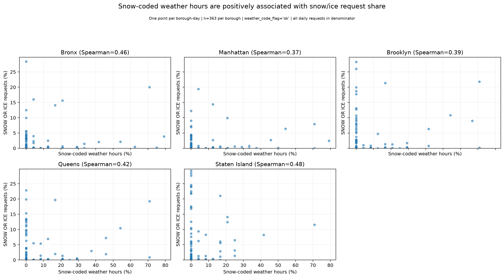
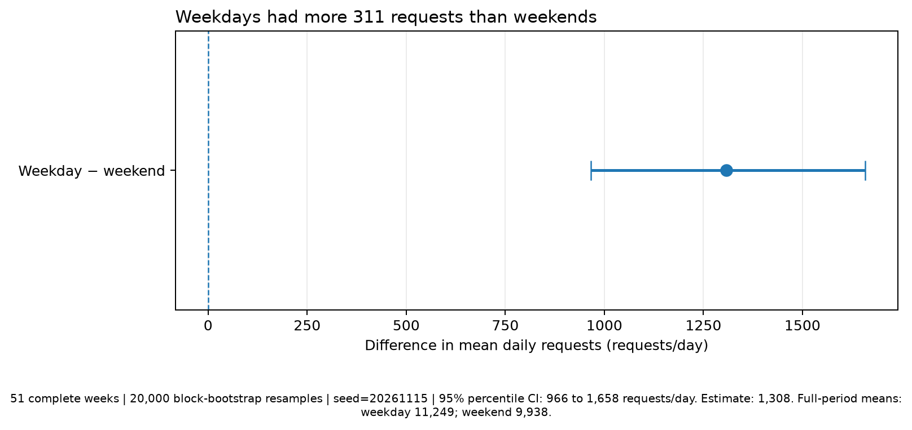

# Exploratory Data Analysis Report — NYC 311 and Open-Meteo

- **Course:** Introduction to Data Science and Engineering
- **Lifecycle stage:** EXPLORE (M4)
- **Analysis window:** 12 October 2025–9 October 2026
- **Timezone:** `America/New_York`
- **Data:** NYC 311 Service Requests and Open-Meteo Historical Weather

**Notebook:** [`notebooks/m4_eda.ipynb`](../notebooks/m4_eda.ipynb)

## 1. Executive summary

This milestone investigates whether the volume and types of New York City 311 service requests vary by borough, local time, calendar period, and weather conditions. The main analysis uses 363 complete local dates (12 October 2025–9 October 2026) and the five named boroughs. The partial 10 October date and `UNSPECIFIED` borough are excluded. The five boroughs account for 3,948,366 requests; the citywide daily mean is 10,877.04.

Raw and cleaned request totals and borough-day counts agree in this window. Daily volume is right-skewed (median 10,784; nearest-rank P95 13,448). The maximum, 22,796 on 24 February 2026, coincides with a snow/ice reporting spike. Brooklyn has the highest borough median (3,330); Staten Island's median is 415 but its maximum is 4,698, illustrating why event days should be retained.

Each borough has 363 request dates and 8,712 expected/observed local weather hours. Temperature, humidity, weather code, wind direction, and cloud cover have 100% `ok` coverage. Precipitation and wind speed contain `unusual_high` flags, so precipitation is evaluated under two flag filters.

Local request volume peaks at 10:00 and reaches its trough at 04:00; the same UTC-resolved requests peak at 14:00 UTC. Snow-coded weather-hour share is positively associated with `SNOW OR ICE` request share (pooled Spearman 0.423; 0.392 after excluding two winter event windows). Weekday volume exceeds weekend volume by about 1,310 requests/day (1,308 in the 51-week block-bootstrap sample; 95% interval 966.42–1,658.44). All findings are exploratory, not causal; a longer or multi-year snapshot is the main thing that could change them.

**M3 issues fixed since the M3 tag:** none; M4 changed no M3 values and no `clean.py` logic.

## 2. Question, scope, and analytical choices

The project asks whether NYC 311 request volume and complaint types vary by borough, local time, weekday, and weather. The primary volume outcome is the daily count of cleaned requests. The weather outcome is the `SNOW OR ICE` share of all requests within each borough-day, separating complaint mix from absolute borough scale.

The saved request snapshot has a partial final date (10 October 2026), so the main analysis ends on 9 October. `UNSPECIFIED` is excluded because it is not one of the five boroughs and cannot be matched to a representative borough weather point; it contains 3,958 requests in the stored snapshot. The selected window contains 3,948,366 requests over 1,815 borough-days.

Mean and median are both reported: the mean describes average volume, while the median is less sensitive to event spikes. Both produce the same borough ranking: Brooklyn, Queens, Bronx, Manhattan, Staten Island. The median is the primary summary for a typical borough-day because daily counts are right-skewed (citywide skewness 1.861) and event days pull the mean upward (for example Bronx: mean 2,321.42 versus median 2,136); the mean is the alternative summary. Counts are not population-adjusted and are not per-resident rates.

## 3. Raw versus cleaned comparison

The M4-required key-number comparison aggregates M2 `service_requests` and M3 `service_requests_clean` to one borough × local date. The raw date is derived from the preserved `created_date_source`; the cleaned date is `created_local_date`. Both queries use the same five borough IDs and the interval 12 October 2025 through 9 October 2026. Each layer contains 1,815 borough-day rows and 3,948,366 requests. No borough-day count mismatch was found. The daily mean is 10,877.04 in both layers.

**Queries.** Both use the same five borough IDs and the interval 2025-10-12 to 2026-10-09 as `?` parameters. Flag filter: none on the request layer (flag-before-fix), so every `created_at_utc_flag` value is retained.

```sql
-- RAW (M2 table)
SELECT borough_id, substr(created_date_source, 1, 10) AS local_date, COUNT(*) AS requests
FROM service_requests
WHERE borough_id IN (?, ?, ?, ?, ?)
  AND substr(created_date_source, 1, 10) >= ?
  AND substr(created_date_source, 1, 10) <= ?
GROUP BY borough_id, substr(created_date_source, 1, 10);

-- CLEANED (M3 layer)
SELECT borough_id, created_local_date AS local_date, COUNT(*) AS requests
FROM service_requests_clean
WHERE borough_id IN (?, ?, ?, ?, ?)
  AND created_local_date >= ?
  AND created_local_date <= ?
GROUP BY borough_id, created_local_date;
```

| Layer | Borough-day rows | Requests | Daily mean (363 days) | Borough-day mismatches |
|---|---:|---:|---:|---:|
| Raw (`service_requests`) | 1,815 | 3,948,366 | 10,877.04 | 0 |
| Cleaned (`service_requests_clean`) | 1,815 | 3,948,366 | 10,877.04 | 0 |

This equality is expected because M3 is a flag-before-fix layer, not a row-filtering step. Records with ambiguous or nonexistent UTC timestamps remain in the cleaned table with their source-local date and a timestamp-quality flag. The comparison does not claim that every timestamp can be converted to UTC; it establishes that the selected daily-volume measure is preserved through cleaning.

## 4. Distribution shape and borough differences

Citywide daily volume has mean 10,877.04, median 10,784, standard deviation 1,631.48, minimum 6,214, maximum 22,796, and skewness 1.861. The nearest-rank P95 is 13,448. Histogram widths of 250, 500, and 1,000 requests were compared. A 500-request width is selected: 250 is more fragmented, while 1,000 hides detail. Figure 1 preserves all three choices.

All borough values rest on n = 363 complete local days each. Brooklyn has the highest median (3,330; mean 3,340.69), followed by Queens (2,636; 2,655.04), Bronx (2,136; 2,321.42), Manhattan (2,114; 2,116.47), and Staten Island (415; 443.41). Borough histograms share a common scale, and ECDFs show the cumulative distributions independent of bin choice.

The Bronx has a long upper tail (P90 3,286 versus median 2,136; skewness 1.980). Staten Island has skewness 10.496 and a maximum of 4,698; on 24 February 2026, 4,154 of these requests (88.42%) were `SNOW OR ICE`. The category and agency breakdowns indicate an event concentration, not a reason to delete the value.









## 5. Coverage, denominators, and flags

The request denominator is one local date per borough; all five boroughs have 363/363 dates and no missing days. The weather denominator is expected borough-local hours, calculated by converting consecutive `America/New_York` midnights to UTC. Each borough has 8,712 expected and observed hours (43,560 across five locations). The 25-hour fall-back and 23-hour spring-forward days offset over the full window.

Temperature, humidity, weather code, wind direction, and cloud cover have 100% `ok` coverage. Precipitation `ok` coverage is 98.69–99.00%, rising to 100% with `unusual_high`; wind-speed `ok` coverage is 97.84–98.46%. With a 90% daily rule, all 363 days pass for temperature and weather code; 347–351 pass for precipitation using `ok`, versus 363 with `ok + unusual_high`.

| Borough | Request days | Weather hours | Temp, humidity, weather code, wind dir., cloud `ok` % | Precip. `ok` % | Precip. `ok`+`unusual_high` % | Wind speed `ok` % |
|---|---|---|---:|---:|---:|---:|
| Bronx | 363/363 | 8,712/8,712 | 100.00 | 98.94 | 100.00 | 98.31 |
| Manhattan | 363/363 | 8,712/8,712 | 100.00 | 98.91 | 100.00 | 98.46 |
| Brooklyn | 363/363 | 8,712/8,712 | 100.00 | 98.69 | 100.00 | 97.84 |
| Queens | 363/363 | 8,712/8,712 | 100.00 | 98.71 | 100.00 | 98.00 |
| Staten Island | 363/363 | 8,712/8,712 | 100.00 | 99.00 | 100.00 | 98.39 |

**Coverage rules.** A daily weather aggregate needs at least 90% of that local day's expected hours with a valid value (22 of 24 hours on a normal day): this tolerates one or two missing hours but stops a day from being summarised from mostly gaps. A daily request count needs a complete local date (partial 10 October excluded). A monthly summary needs at least 90% of calendar days (partial October 2025 and October 2026 excluded). A bootstrap block needs seven complete Monday–Sunday days.

**Precipitation with and without the 90% daily rule, under both flag filters.**

| Borough | `ok` only, no rule: days / mm | `ok` only, ≥90%: days / mm | `ok`+`unusual_high` (all 363 days pass): mm |
|---|---:|---:|---:|
| Bronx | 363 / 857.7 | 350 / 707.3 | 1,315.0 |
| Manhattan | 363 / 843.2 | 349 / 682.8 | 1,326.7 |
| Brooklyn | 363 / 771.2 | 347 / 584.3 | 1,337.5 |
| Queens | 363 / 818.8 | 349 / 652.4 | 1,417.8 |
| Staten Island | 363 / 817.2 | 351 / 649.2 | 1,276.8 |

**Reported filter.** Precipitation totals are reported with `ok + unusual_high`; `ok` only is the strict sensitivity view. The `unusual_high` flag means unusual, not invalid, and dropping those hours removes the heaviest rain. The snow analysis uses `weather_code_flag = 'ok'`, which has 100% coverage, so it does not depend on this choice.

The filter materially changes period precipitation totals: `ok`-only totals range from 771.2 to 857.7 mm, versus 1,276.8 to 1,417.8 mm with `ok + unusual_high`. These flags mean unusual, not automatically invalid. Both are retained as sensitivity views. Snow exposure uses the fully covered `weather_code_flag = 'ok'` series and WMO codes 71, 73, 75, 77, 85, and 86.

## 6. Time, calendar, and local clock

The local-time analysis retains 3,948,366 requests. The UTC-resolved subset contains 3,947,569; 796 records are `ambiguous_local_time` and one is `nonexistent_local_time`. These 797 remain in local-date/hour analyses but are omitted from UTC comparisons. For resolved records, UTC is four hours ahead for 2,564,221 requests and five hours ahead for 1,383,348.

Local volume peaks at 10:00 (657.62 requests per citywide clock-hour occurrence) and bottoms at 04:00 (127.51). The same UTC-resolved subset peaks at 14:00 UTC and bottoms at 08:00 UTC. This is a clock-label shift, not a change in underlying requests; behavioural interpretation should use `America/New_York`.

Tuesday has the highest mean daily count (11,674.71), while Saturday has the lowest (9,829.76). Among complete months, February 2026 is highest (11,945.43) and April lowest (10,059.63). Partial October 2025 (20/31 days) and October 2026 (9/31) are excluded. These describe one snapshot, not a stable multi-year seasonal cycle.

The 11 federal holiday dates average 9,900.09 requests versus 11,308.54 on non-holiday weekdays (difference −1,408.45). The small, heterogeneous sample includes 13,062 requests on 3 July 2026. Federal holidays are calendar indicators, not proof that every NYC service unit was closed; the comparison is descriptive only. The observed dates follow the U.S. Office of Personnel Management federal holiday schedule ([OPM holiday calendar](https://www.opm.gov/policy-data-oversight/pay-leave/federal-holidays/)).









## 7. Weather relationships and event sensitivity

For each borough-day, the main relationship compares the share of valid weather hours with snow-coded WMO codes against the share of requests categorised as `SNOW OR ICE` (n=1,815). Pooled Pearson is 0.2657 and Spearman is 0.4228. Borough Spearman values are all positive: Bronx 0.458, Brooklyn 0.394, Manhattan 0.371, Queens 0.419, and Staten Island 0.477. The monotonic association is stronger than the linear correlation.

Two event windows are checked: 25–31 January and 21–28 February 2026. Excluding them leaves 1,740 borough-days; Spearman remains positive at 0.3924. The events strengthen but do not wholly explain the pattern. Snow/ice requests rose across all boroughs on 23 February, and Staten Island reached its maximum on 24 February. The event days are retained.

Lag analysis pairs exposure on day *t* with requests on *t+1* or *t+2*. The pooled lag-one Pearson coefficient is 0.4960 (n=1,810); lag two is 0.4315 (n=1,805). After excluding storm exposure/outcome dates, lag-one remains positive (Pearson 0.4223; Spearman 0.3946; n=1,725). Monthly lag-one coefficients vary and are undefined where either variable has no variation. This is compatible with delayed reporting but does not prove it.

Same-day precipitation totals have weak/negative pooled Spearman coefficients: −0.1004 for `ok` only and −0.1086 for `ok + unusual_high`. Precipitation is water-equivalent, not snow depth; snow-coded hours are the more direct exploratory exposure for this snow/ice question.





## 8. Difference, uncertainty, and comparison count

The full window contains 260 weekdays and 103 weekend days. Mean daily volume is 11,248.95 on weekdays and 9,938.24 on weekends: a 1,310.71 difference (about 13.2% of the weekend mean). Medians are 11,037 and 9,738.

Uncertainty is estimated by resampling 51 complete Monday–Sunday weeks as blocks (20,000 repetitions; seed `20261115`). The bootstrap sample has 255 weekdays and 102 weekend days. Its mean difference is 1,308.16, with a 95% percentile interval of 966.42–1,658.44. The interval excludes zero, but it does not account for every source, seasonal, or measurement uncertainty.





Among 11 months with at least 90% calendar coverage, weekday mean is higher in all 11. The equal-month-weighted mean difference is 1,302.09; monthly gaps range from 2,191.39 in January to 391.45 in June. Composition check: weekday and weekend groups have similar monthly mixtures (every eligible month has 20–23 weekdays and 8–10 weekend days), so the comparison does not reverse within months (no Simpson's-paradox reversal). The 260 weekdays include 11 federal-holiday dates (mean 9,900.09), which lower the weekday mean; from the reported means, the weekday−weekend difference without them is about 1,370 requests/day (11,308.54 − 9,938.24), so the headline difference is conservative on this point. This comparison was chosen post hoc. The look-count context is seven weekday summaries plus 13 monthly summaries (about 20 temporal summaries), alongside weather and event analyses; it is not a pre-registered test.

## 9. Findings register and implications

| ID | Finding | Evidence | Label | What would change it | Explored by |
|---|---|---|---|---|---|
| F1 | Raw and cleaned daily counts agree for the selected window. | §3 queries; 3,948,366 requests; 1,815 borough-days in both layers; 0 mismatches. | Confirmed (arithmetic) | A different date/borough filter or revised source snapshot. | Şeyma Nur Demirkoparan |
| F2 | Citywide daily volume is right-skewed. | Figures 1–3; skewness 1.861; median 10,784; P95 13,448; maximum 22,796. | Exploratory | A longer snapshot could reveal whether extreme days recur. | Şeyma Nur Demirkoparan |
| F3 | Local clock shows a mid-morning peak. | Figure 5; 10:00 local peak; UTC-resolved profile peaks at 14:00 UTC. | Exploratory | A different timezone convention or source timestamp correction. | Şeyma Nur Demirkoparan |
| F4 | Snow-coded weather hours are positively associated with snow/ice request share. | Figure 4; pooled Spearman 0.423; 0.392 after event-window exclusion. | Exploratory | Multi-year data, adjusted temporal models, or alternative weather products. | Şeyma Nur Demirkoparan |
| F5 | Weekday volume exceeds weekend volume. | Figure 8; difference 1,308.16 in complete-week bootstrap; 95% CI 966.42–1,658.44; same direction in 11/11 months; post-hoc choice (~20 looks). | Exploratory | Longer period, different snapshot, or temporal dependence adjustments. | Şeyma Nur Demirkoparan |
| F6 | Holiday dates have lower mean counts than other weekdays. | 11 holiday dates; mean difference −1,408.45 (notebook holiday cell). | Exploratory | Service-specific operating calendars and a larger number of years. | Şeyma Nur Demirkoparan |

**Back to cleaning:** none required. Exploration found no new cleaning error, so `docs/cleaning_report.md` (M3 issues register) and `src/clean.py` are unchanged, and no M3 values are changed in this milestone. Keep the 797 unresolved UTC creation timestamps; do not invent an instant. Keep `unusual_high` precipitation and wind values as flagged observations, and report strict/inclusive sensitivity. Retain event days, especially the February 2026 snow/ice spike. Do not impute any missing weather values into the M3 cleaned layer.

**Forward to modelling:** model request count and complaint composition as separate outcomes. Use borough, local hour, weekday, month/season, federal-holiday indicator, snow-coded exposure, precipitation under both flag rules, and one- or two-day weather lags as candidate predictors. Account for temporal autocorrelation, overdispersion, borough-level heterogeneity, event clustering, and possible delayed reporting. Use a time-based holdout rather than a random row split. A population denominator would be required before making per-capita claims.

## 10. What we can't say: limitations and reproducibility

The analysis covers one approximately annual snapshot. `UNSPECIFIED` requests cannot be assigned to representative weather points; the five Open-Meteo grid points do not capture within-borough microclimates. Precipitation is water-equivalent, not snow depth. Request volume also depends on reporting awareness, channels, service practices, and submission delay. Correlations do not establish causation, and counts are not adjusted for population or exposure. Staten Island is a thin group (median 415 requests/day), so its shares and ratios are volatile on event days, and every finding in §9 is exploratory.

The notebook uses SQL aggregation, parameterized filters, and read-only SQLite. It generates eight figures. Reproduce after restoring the M1 raw snapshot with `python3 src/load.py`, `python3 src/clean.py`, and `python3 src/validate.py`; then run `jupyter nbconvert --to notebook --execute --inplace notebooks/m4_eda.ipynb`. Commit the executed notebook outputs. The database remains a local build artifact, not a Git file.

Weather data attribution: **Weather data by Open-Meteo.com.** See the [Open-Meteo Historical Weather API](https://open-meteo.com/en/docs/historical-weather-api) and [Creative Commons Attribution 4.0 International licence](https://creativecommons.org/licenses/by/4.0/).

### Team exploration record

| Team member | Exploration performed / reviewed | Evidence or notebook section |
|---|---|---|
| Şeyma Nur Demirkoparan | Performed the complete M4 exploratory analysis, including data reconciliation, distribution and borough comparisons, coverage checks, time and calendar profiles, weather and snow/ice sensitivity analysis, weekday–weekend comparison with block-bootstrap confidence intervals, figure generation, and report preparation. | `notebooks/m4_eda.ipynb` (analysis and validation); Figures 1–8; `docs/eda_report.md` |
| Melike Aldemir | No M4 exploratory-analysis tasks were performed for this milestone. | N/A for M4 |
